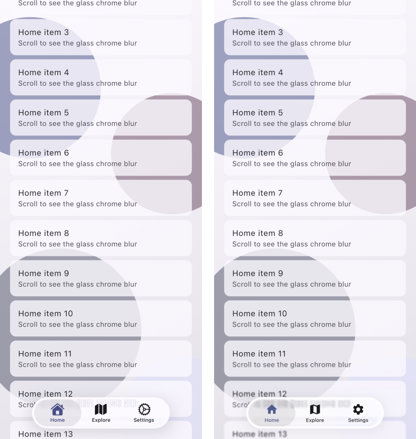
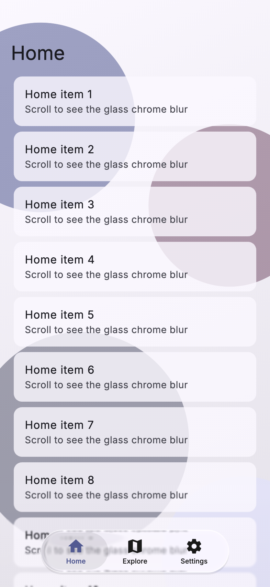
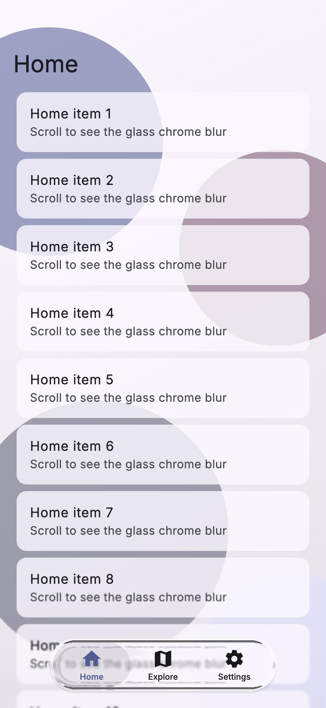
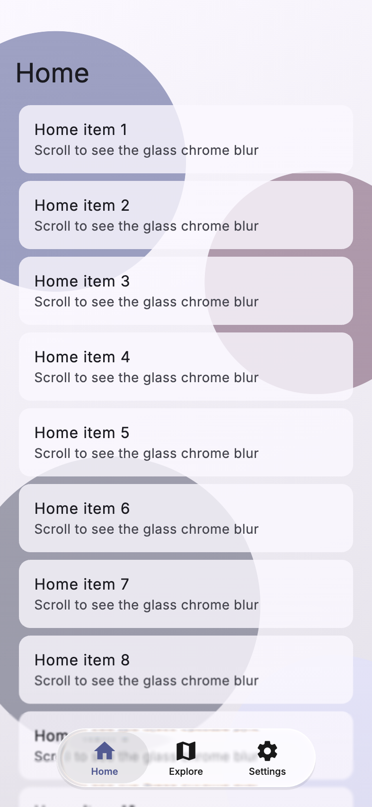
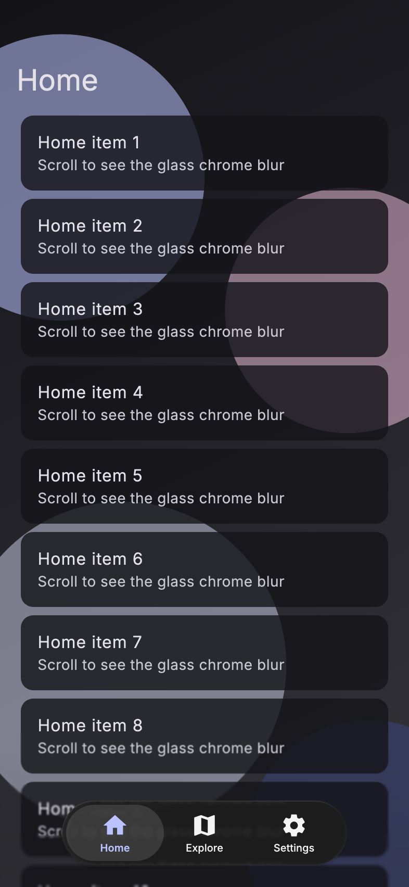

# The liquid tier

`LiquidGlass` draws liquid glass by default wherever Flutter runs on
Impeller: iOS, Android 10+ and macOS. The web, Windows and Linux have no
Impeller shader filters by default, so glass there is frosted. The lens
is this package's own fragment shader; no other package is involved.



## What it draws

- **Lens.** Across a 20pt band inside the edge the glass curves down like
  a thick lens. Content under that band is pulled in by up to about 27pt,
  so the band shows a mirrored strip of what lies further inside, as
  iOS 26 glass does; the middle is flat.
- **Specular rim.** A thin highlight, strongest on the top-left edge and
  fainter on the opposite one, plus a soft glow across the band.
- **Dispersion.** Red and blue bend slightly differently in the band, a
  faint colour fringe. It is off by default (`dispersion: 0`), as iOS 26.5
  shows a fringe only on a touched lens; raise it for a fringe on every
  surface.
- **Blur and tint.** A light blur (σ 2) and the `liquidTint` colour,
  so what lies behind the glass stays recognisable.

A side that touches the screen edge (the sidebar's outer edges) has no
lens and no rim.

## Theme

| Field | Default | Effect |
|---|---|---|
| `liquidTint` | surface @ 40 % (light), 45 % (dark) | Colour over the glass; raise its alpha for more legibility |
| `refraction` | 1 | Lens strength; 0 is flat glass, 2 doubles it |
| `dispersion` | 0 | Colour fringe, 0–1 |
| `liquidBlurSigma` | 2 | Blur under the lens; 0 for none |

The same screen with one field changed at a time:

| `refraction: 0` | default (`refraction: 1`) | `refraction: 2` |
|---|---|---|
|  |  |  |

| `dispersion: 0.3` | default (`dispersion: 0`) | default, dark |
|---|---|---|
|  |  |  |

## The tab lens and the pocket

**The tab lens.** At rest the selected tab of the Flutter tab bar sits in
a flat `selectionFill` capsule, with no extra pass. A touch engages a
second liquid pass at the capsule: a `LiquidLens` that reads the same
backdrop as the pill, so it bends the page behind the bar rather than the
pill. It has a 14 pt refracting ring around a flat core, a milky veil
(white at 0.90 in light, `colorScheme.surface` at 0.90 in dark), a σ 2
blur, a 1 pt rim, a soft shadow, and a rainbow fringe that grows with the
press (dispersion up to 0.6), the only fringe the default theme draws.
It fades in and out as one layer. On the frosted tier the lens is a
lightly blurred white capsule with a rim; on solid, an opaque capsule.
More in [tab_bar.md](tab_bar.md).

**The scroll-edge pocket.** Under the liquid bottom bar the page fades
into a soft blur and a faint dim over the bottom 148 pt, as iOS 26 draws
its scroll-edge pocket. Flutter has no variable blur, so it is three
bands of 49.3 pt (σ 0.5, 1.0 and 1.6 from top to bottom) and a gradient
to black at 1.2 % (light) or 8 % (dark). Only the liquid tier with
`liquidBlurSigma > 0` draws it: frosted, solid and Reduce Transparency
have none.

## Defaults changed in 0.1.0-dev.6

`LiquidGlassTheme.fromColorScheme` changed these defaults for every glass
surface (bars, circles, the sidebar, dialogs, the back button), to match
the iOS 26.5 material:

| Field | Was | Becomes |
|---|---|---|
| `rimHighlight` | white @ 0.50 (light) / 0.18 (dark) | white @ 0.12 (light) / 0.22 (dark) |
| `shadow` | `0x24000000`, (0, 6), blur 20, spread −2 | `0x12000000` (7 %), (0, 3), blur 20, spread 0 |
| `dispersion` | 0.3 | 0 (the touched tab lens sets its own) |
| `labelStyle` | 10 / 1.4 / w600 / 0.4 | 10 / 1.2 / w500 / 0 |

It also gained `selectionFill`, `tabForeground`, `badgeColor` and
`tabIconSize` (see [theming.md](theming.md)). Pass the old values through
`copyWith` for the previous look.

## When it is not drawn

The tier drops to **frosted** without Impeller (Android 9 and lower, the
web), on Android 10+ devices without Vulkan 1.1 or with less than 3 GiB of
memory, in battery saver or iOS Low Power Mode, after sustained slow
frames, inside another `BackdropFilter`, and until the shader has loaded.
It drops to **solid** with Reduce Transparency, Increase Contrast, or
window blurs disabled outside battery saver. See [tiers.md](tiers.md).

## Limitations

- **Opaque output.** The lens writes opaque pixels. That is invisible in
  an opaque app, and an `Opacity`, `FadeTransition` or fading page
  transition above the glass fades it like frosted. But over a
  transparent backdrop it is a solid slab of the tint over black, not
  see-through glass:
  - add-to-app with a transparent `FlutterView`, or Android
    `TransparencyMode.transparent`;
  - an overlay window;
  - an image capture of a subtree (`RepaintBoundary.toImage`,
    share-as-image features).

  Force frosted for those surfaces:

  ```dart
  LiquidGlassScope(
    policy: const LiquidGlassPolicy(forcedTier: LiquidGlassTier.frosted),
    child: shareableCard,
  )
  ```

- **Scaled or rotated ancestors.** The lens is placed on the glass's
  axis-aligned bounding box in screen pixels, and its corner radii, bezel,
  thickness and rim keep their unscaled size. Under a `Transform.scale`
  or a rotation (zoom page transitions, scale-in dialogs,
  `CupertinoContextMenu`) the lens corners therefore do not match the
  clip, and a rotated glass gets a misplaced lens. A transition is over in
  a few frames; for glass that stays transformed, force frosted.
- **One frame of lag.** The nearest route's transition and the nearest
  `Scrollable` repaint the lens in the same frame. Any other move is
  caught by a check after each frame and corrected one frame late: glass
  under a `CompositedTransformFollower`, or moved by an outer
  `Navigator`'s route or an outer `Scrollable`.
- **Inside another `BackdropFilter`** glass draws frosted: the lens cannot
  be placed in a nested filter's coordinates.

## First frame

The shader loads when the first `LiquidGlass` mounts; until then glass is
frosted and then cross-fades. To start liquid:

    Future<void> main() async {
      WidgetsFlutterBinding.ensureInitialized();
      await LiquidGlass.precache();
      runApp(const MyApp());
    }

## Cost

All chrome shares one backdrop copy (`BackdropGroup`). Each surface adds a
small blur and one pass of the lens over its own area. Never put glass on
list cells. The pocket adds three blur passes over its 148 pt. The tab
lens adds one pass only while the bar is touched or the lens is moving
(under a second after release); at rest it costs nothing.

In profile and release builds a frame guard watches raster times while
liquid glass is on screen. After three windows of 60 frames in a row whose
90th percentile is above 1.25 × the frame budget (1 s / refresh rate, never
less than 16.7 ms), the glass turns frosted for the rest of the session.

## Provenance

The shader is written from first principles (a rounded-rect distance
field, Snell's law, a Fresnel-like rim). No other glass package's code
was read or copied.
