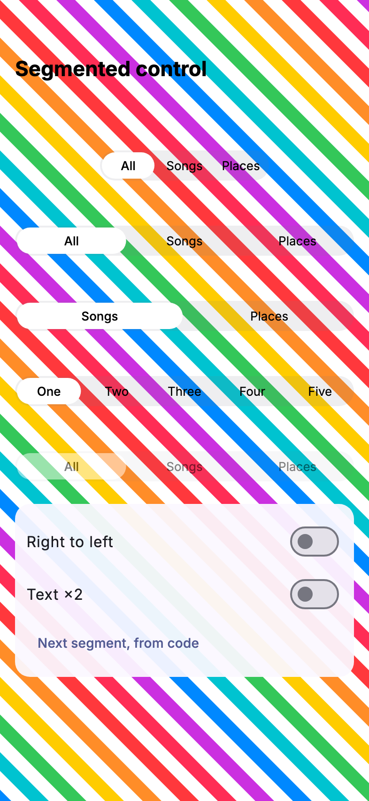

# The segmented control

`LiquidSegmentedControl` is modelled on iOS 26's `UISegmentedControl`,
for Flutter, and approximates it (see
[What is not identical to iOS](#what-is-not-identical-to-ios)): a flat
track with a white thumb, and a liquid lens that lifts under the finger,
follows a drag across the segments and lands with a wobble. The search
scopes use it ([search.md](search.md)); it is public so the rest of your
app can too. It is text-only: icons and momentary segments are not part
of it.



## API

```dart
LiquidSegmentedControl(
  segments: const [
    LiquidSegment(label: 'All'),
    LiquidSegment(label: 'Songs'),
    LiquidSegment(label: 'Places', enabled: false),
  ],
  selectedIndex: _scope,
  onChanged: (i) => setState(() => _scope = i),
)
```

| Member | What it does |
|---|---|
| `segments` | Two or more `LiquidSegment`s, in index order (right to left in RTL) |
| `selectedIndex` | The selected segment, or null for none. The control is controlled: rebuild it with the index `onChanged` gives. If you do not, the lens returns to the segment you still select |
| `onChanged` | Called with the segment the user chose, on release. Not called for the selected segment, a disabled one or an app-made change. Null disables the whole control (drawn at half opacity) |
| `expand` | True (default): fill the width given. False: size to the labels, each segment as wide as the widest label plus 18, and at least 44 |
| `semanticLabel` | What a screen reader says for the control as a whole |
| `LiquidSegment.label` | The title |
| `LiquidSegment.enabled` | False: not tappable, never the target of a drag, label at half opacity |
| `LiquidSegment.semanticLabel` | The segment's spoken label, when it differs from `label` |

Under an unbounded width (a `Row` without `Expanded`) the control sizes to
its labels either way. It never overflows: in a narrow width every
segment shrinks equally and labels that do not fit end in an ellipsis.
Asserts: two or more segments, and `selectedIndex` inside them.

## Geometry

| Part | Size |
|---|---|
| Track | 32 pt tall at text scale 1, a capsule |
| Box | 44 pt tall; the track is centred in it, 6 pt above and below |
| Thumb at rest | the segment minus an inset of 2 pt, so `(segment - 4) x 28` |
| Pressed lens | the thumb plus 24 x 16, so 44 pt tall |
| Lens bezel | 9 pt |
| Label | 13 pt, w400; w500 on the selected one; in the system font, UIKit's tracking |

Every segment's tap target is the full 44 pt box height by its width, with
no gaps. Native's control is 32 pt tall; yours takes 12 pt more layout,
and looks the same.

## Theming

Three fields of [`LiquidGlassTheme`](theming.md):

| Field | Light | Dark |
|---|---|---|
| `segmentTrack` | `#767680` @ 0.12 | `#767680` @ 0.24 |
| `segmentThumb` | `#FFFFFF` | `#EBEBF5` @ 0.30 |
| `segmentLabelStyle` | 13 pt, w400, black | 13 pt, w400, white |

The label keeps the app's font (`ThemeData.fontFamily`); set
`segmentLabelStyle.fontFamily` to choose another. In the system font (on
iOS and macOS) the labels track as UIKit tracks it, by their drawn size
(−0.078 pt at 13 pt): UIKit applies SF Pro's tracking and Flutter's text
engine does not, so without it the labels, and an intrinsic control, came
out wider than native's. Any other font, the app's own included, keeps its
spacing; a `letterSpacing` in `segmentLabelStyle` wins either way. The selected label and
the one under the lens are w500. A disabled control is drawn at half
opacity.

## Motion

- **A tap commits on release**, as native does. The lens lifts when the
  finger lands on the selected segment; on another segment the label fades
  while it is held, and the lens flies there on release. On the way it
  lifts, wide when it goes right and tall when it goes left (as native's,
  whatever the distance), then lands with a wobble that keeps its area: as
  it narrows it grows taller, as it flattens it grows wider.
- **A drag** moves the lens with the finger, clamped to the first and last
  segment, and squashes a little at speed. On release it commits the
  segment nearest the lens; after a flick, the segment under the finger.
- **Selection clicks.** `HapticFeedback.selectionClick()` plays once per
  segment the lens crosses while dragging. A tap, a release and an app
  change play none.
- **An app change** (`selectedIndex` changed by your code) slides the thumb
  without the lens and does not call `onChanged`.
- The lens is the same engine as the [tab bar](tab_bar.md)'s, with the
  segment springs.

## Accessibility

- Each segment is a button in a mutually exclusive group, with selected and
  enabled states; the order follows the screen, in LTR and RTL. A semantics
  tap commits at once. Keyboard focus moves between enabled segments with
  Tab or the arrow keys, shows a ring, and Enter or Space commits.
- **Reduce motion:** a tap dissolves the thumb from one segment to the
  other in 150 ms, no slide, lift or wobble.
- **RTL** mirrors the segments, the drag and the crossings.
- **Text scale** follows the system up to x2: the track grows with the
  line, labels that do not fit end in an ellipsis. At accessibility sizes a
  long press shows the label in the large content viewer.
- Every segment is at least 44 pt tall; see below for width.

## Tiers

On the liquid tier the lens is a second glass pass over the control,
drawn only while a finger touches it, so a control at rest costs two fills
and text. The frosted and solid tiers draw the lens as their own fills; the
track and the rest thumb are fills on every tier. With reduce transparency
or increased contrast there is no lens pass, only the thumb.

## What is not identical to iOS

Measured against a `UISegmentedControl` on iOS 26.5; the numbers come
from the acceptance measurements.

- **Track.** Flat, like native's. Only the lens is glass. iOS 27's
  glass track is not drawn.
- **Size.** The box is 44 pt, not 32. Intrinsic segments are at least
  44 pt wide: "A | B | C" is 132 pt where native's is 96. Longer labels
  match native to within a point ("All | Songs | Places" is 177 pt).
- **Width below 44 pt per segment.** The segments shrink equally to fit,
  so hit targets follow the segment width and are narrower than 44 pt
  there. They stay 44 pt tall.
- **Text scale.** Native's labels stay at 13 pt; these follow the
  system text size up to x2, which is the Flutter convention.
- **Wobble.** The lens lifts and lands with springs matched to
  native's peaks, overshoot and settle time within 10 %, not frame by
  frame: on the 31 native taps it was fitted to, which cover every kind of
  tap measured (two, three and five segments, left and right, LTR and
  RTL), and on 73 more captures that repeat the same kinds of tap. The 73
  show that the fit repeats, not that it holds for new kinds of tap. What
  differs: on five segments a tap over three or four segments slides with
  a larger overshoot (4.2 to 5.6 pt against 3.0 to 4.3) and, to the right,
  narrows more after its lift; on two segments the slide is 2 pt off for a
  frame or two. The overshoot after a fast release changes with its speed here,
  where native's barely does: 4.4 pt against 4.04 at about 630 pt/s, 3.1
  to 3.4 against 3.86 at about 450.
- **Lens look.** Clear glass with a thin rim, a refracting ring with a
  colour fringe, and the page under it squeezed to about 0.8 across its
  height, as native's. Native's lens also bends the labels it passes; here
  they stay above it, and native's fringe is stronger.
- **Segments.** Text only, with a per-segment `enabled`. No icons, no
  momentary mode.
- **Haptics.** One selection click per segment crossed while dragging; the
  device's own pattern for native's control could not be observed on the
  simulator.
