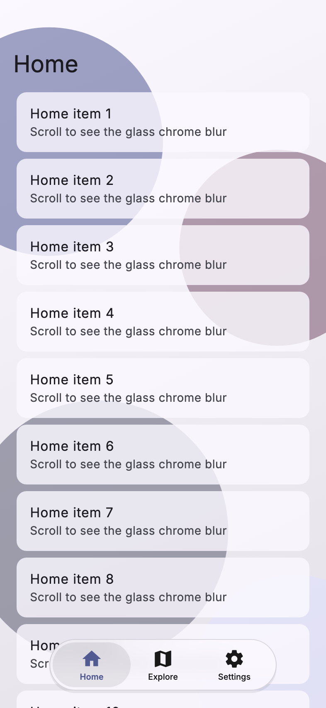
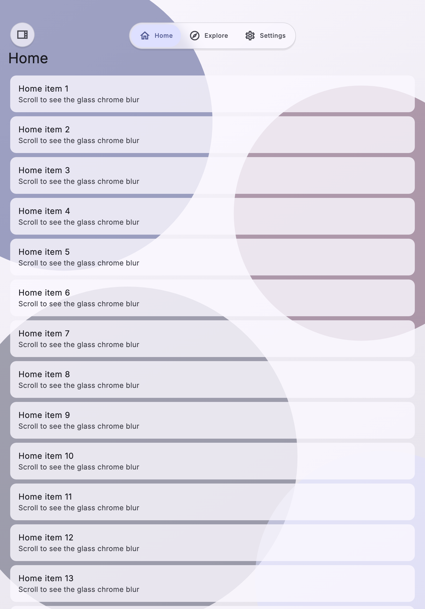

# The Flutter tab bar

On iOS 26 with native chrome, UIKit draws the tab bar. Everywhere else
(iOS 15–25, Android, or a forced glass tier) `liquid_shell` draws its own,
measured against iOS 26.5 and built to match it.

| Phone | iPad portrait |
|---|---|
|  |  |

## Geometry

- **Compact (phones, portrait).** A 62 pt pill, 21 pt from the screen
  edges and bottom. Each tab gets an 86 pt slot until the pill reaches the
  row width (`16 + 86 × tabs`). The selection capsule is the slot plus
  8 pt, so neighbours overlap. With a trailing action or the search ⌕,
  the pill sits at the start and the circle at the end.
- **Landscape phones.** A 44 pt pill, icon beside a 12 pt label, each tab
  as wide as its label plus 49 pt. A landscape shell lower than
  `LiquidShellBreakpoints.compactHeight` (500 by default) gets this bar;
  `compactHeight: 0` keeps the top bar there instead.
- **Regular (iPad).** A 48 pt pill at the top, label only (17 pt), the
  search tab as an icon. It sits 5.5 pt below the safe area.
- **Narrow shells.** Below `kLiquidNarrowWidth` (340 pt of the shell's own
  width) the row margin drops from 21 to 8 pt, so five tabs and a trailing
  action keep tap areas wider than 44 pt at 320 pt.

## The lens

At rest the selected tab sits in a soft gray capsule. Touch the bar and
the capsule turns into a clear glass lens:

- it bends the page behind it, with a rainbow fringe at its edge;
- it follows your finger;
- it magnifies and tints the icons under it;
- it snaps to the nearest tab when you lift your finger, or, after a
  flick, to the tab under your finger.

The tab is selected when you lift your finger, as on iOS. A tap slides the
lens across with the springs measured from iOS 26.5. The whole bar swells
slightly while you hold it, and a soft glow follows your finger and
ripples out when you let go.

A selection your code makes (a deep link, a guard that answers late) jumps
straight to the new tab, as UIKit does when `selectedIndex` is set. A
selection that `beforeDestinationChange` refuses slides the lens back.

## Icons

iOS draws a filled SF Symbol in every tab. Flutter cannot draw SF
Symbols, so give each destination a filled `selectedIcon`. The tab bar
draws `selectedIcon ?? icon` in every slot, and the sidebar draws
`icon` / `selectedIcon` by selection:

```dart
LiquidDestination(
  icon: Icon(Icons.home_outlined),
  selectedIcon: Icon(Icons.home),
  label: 'Home',
  sfSymbol: 'house',
)
```

Pairs that read like the SF Symbols of the example app:

| Destination | `icon` | `selectedIcon` | `sfSymbol` |
|---|---|---|---|
| Home | `Icons.home_outlined` | `Icons.home` | `house` |
| Explore | `Icons.map_outlined` | `Icons.map` | `map` |
| Settings | `Icons.settings_outlined` | `Icons.settings` | `gear` |
| Inbox | `Icons.inbox_outlined` | `Icons.inbox` | `tray` |

`LiquidGlassTheme.tabIconSize` (26 by default) sizes Material icons to
SF's optical size. Tune it for other icon fonts. The package adds no icon
font: to use `CupertinoIcons`, add `cupertino_icons` to your app and pass
them yourself.

## Colours

The selected tab is `ColorScheme.primary`, the tint the native chrome
uses too. The other tabs are `LiquidGlassTheme.tabForeground` (#191919
in light, #F4F4F4 in dark), the rest capsule is `selectionFill`, and
badges are `badgeColor` (#FF383C, #FF4245 in dark). See
[theming.md](theming.md).

## Minimize on scroll

Scrolling down shrinks the bar to a 48 pt circle with the current tab's
icon. Tap it to bring the bar back. Scrolling back toward the top does
not, as on iOS 26. A selection change brings it back too. A `chromeBuilder` reads the same
state in `LiquidChromeDetails.minimized` and expands with
`details.expand`.

## The scroll-edge pocket

On the liquid tier the page fades into a soft blur and a faint dim over
the bottom 148 pt, under the bar, as iOS draws its scroll-edge pocket.
Under the 44 pt landscape bar it is 128.8 pt: native starts the pocket
64.8 pt above the pill in both forms.
Frosted and solid glass, and Reduce Transparency, draw no pocket.

## Accessibility

- **Reduce Motion.** No sliding, swelling or glow. A tap cross-fades the
  selection, and a drag moves a plain capsule.
- **Reduce Transparency, Increase Contrast.** The solid tier: opaque bar
  and lens, a border under Increase Contrast.
- **Large text.** Tabs become icon-only, and a long press shows the large
  content viewer.
- **VoiceOver and TalkBack.** One button per tab, with its badge in the
  label.

## Haptics

A selection click each time the lens crosses into another tab while you
drag. Plain taps are silent.

## What is not identical to iOS

- The glass material is matched by measurement, not by Apple's private
  filter. It does not re-tint by the brightness behind it, and there is
  no device-motion light: the rim highlight stays put when the device
  tilts.
- Corners are plain circular arcs, not Apple's continuous corners. On a
  capsule the difference is under 1 pt.
- Icons are your icon font, not SF Symbols. On iOS 15–25 the package does
  not borrow the system's symbol images either.
- Labels and icons use solid colours, not iOS's vibrancy, so over a very
  colourful page they do not take on its hue.
- The lens's squash and stretch is a two-spring model: the peaks and timing
  match, some in-between frames do not.
- The touched lens's rainbow fringe is fainter than iOS's at the ends of
  the lens.
- **Dark mode lens (unverified).** The touched lens in dark mode is a
  `colorScheme.surface` veil, an assumption: no dark iOS capture was
  available, so it may read darker than iOS's.
- The scroll-edge pocket is three blur bands, not a continuous blur.
- Glass over a platform view (map, web view) cannot see it. Force
  `frosted` or `solid` on such pages.
- A narrow iPad window's bottom bar uses the iPhone measurements, and the
  look is iOS 26.5's, not iOS 27's.
- No iPad tab customization on long press. A long press swells the lens,
  as on iPhone.
